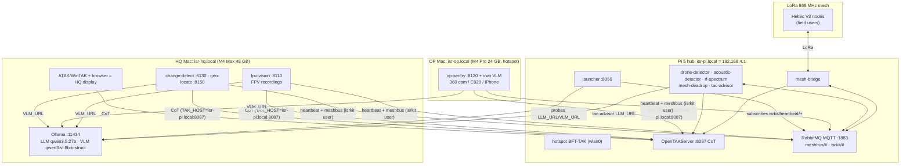
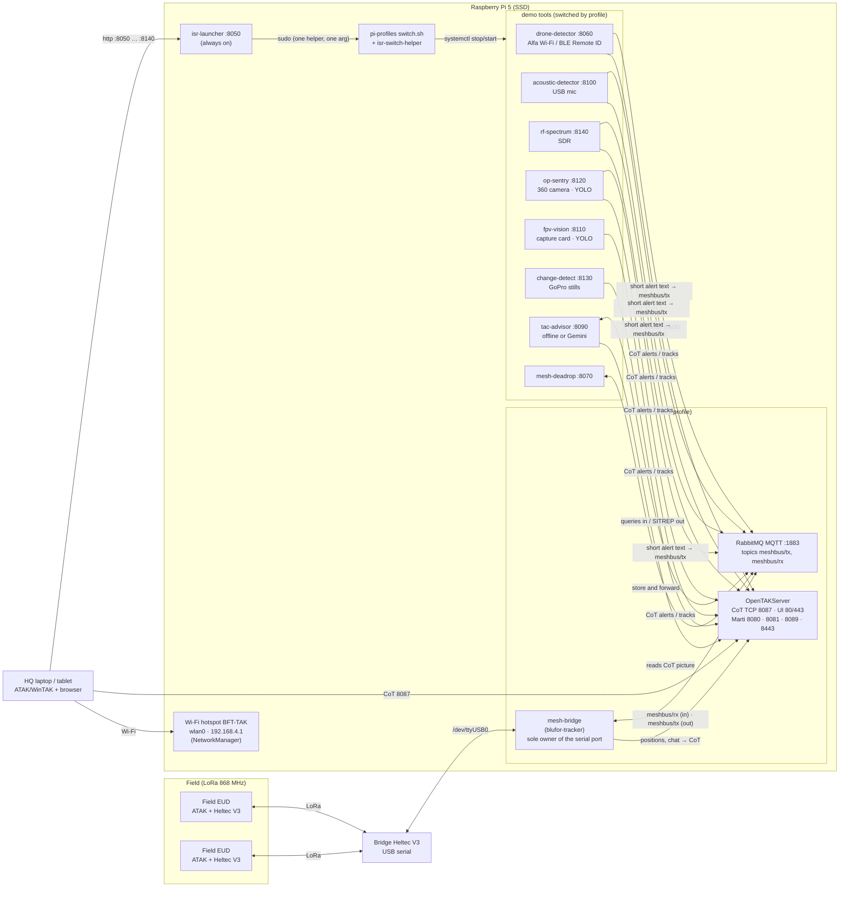

# ISTAR demo kit: architecture

The Raspberry Pi 5 is the **hub**: hotspot, OpenTAKServer, mesh bridge, MQTT broker, launcher and the light, non-vision tools. It can run the whole kit on its own (**Pi-only**). Two Apple Silicon Macs can join its hotspot as **compute stations** for the vision tools and a local LLM/VLM (**Mac-assisted**), and Gemini can be added when there is internet (**Gemini-online**). `pi-profiles` decides what runs on the Pi. The hotspot, OTS, mesh bridge and launcher stay up the whole time, and everything else is swapped around them.

The integration contract (addresses, ports, env vars, MQTT topics, heartbeat) is in [CONTRACT.md](CONTRACT.md).

## Three-node topology (Mac-assisted)

All three nodes are on the Pi's hotspot. Nothing needs internet. Gemini is used only if a tool has `GEMINI_API_KEY` and the hub has an uplink.

## Deployment variants

| variant | Pi runs | Macs run | AI tier | profiles |
|---|---|---|---|---|
| **Pi-only** (fallback: no Macs) | everything it can, one camera-YOLO tool (op-sentry; no fpv-vision) | nothing | offline templates (or Gemini if online) | `demo-full` ("Pi only (fallback: no Macs)") |
| **Mac-assisted** (recommended when Macs are available) | hub + drone-detector, acoustic, rf, deadrop, tac-advisor | HQ: Ollama + change-detect + geo-locate + fpv-vision; OP Mac: op-sentry | **Mac VLM/LLM** | `demo-full-mac` (continuous simulators) or `demo-step-mac` (step by step: the presenter fires each event) |
| **Gemini-online** | as either of the above | as above | Gemini (when the Macs are down or for comparison) | any; set `GEMINI_API_KEY` |

The AI fallback ladder is **Mac VLM → Gemini → off**. The launcher's status pill shows which tier is usable right now: it probes `LLM_URL`/`VLM_URL` and checks whether Gemini is reachable. "Off" still gives detections, tracks and CoT, and only loses natural-language descriptions.

A `*-mac` profile lists the tools it expects on the Macs (`# @remote fpv-vision@hq, op-sentry@op, …`). The mission board shows each one as a card with its station; the engineer view lists it under **Mac stations** with its heartbeat state (live, stale after 30 s, offline after 120 s), mode and UI link. Switching to a `*-mac` profile also stops any Pi copy of those vision tools (they're catalogue units outside the profile).

## Pi-only component view

## Data flows

**Mesh to TAK (blue force picture).** Field users' phones run ATAK with a Heltec V3 paired by Bluetooth (the Meshtastic ATAK plugin, device role `TAK`). Positions and chat cross LoRa to the bridge radio on the Pi. `mesh-bridge` decodes them and pushes CoT to OpenTAKServer on 8087, and HQ sees them move.

**meshbus (everything else on the radio).** Only `mesh-bridge` opens the serial port. Other tools publish to the RabbitMQ MQTT plugin on `127.0.0.1:1883`:

| topic | direction | used by |
|---|---|---|
| `meshbus/rx` | radio → tools (messages received off the mesh) | tac-advisor (queries), mesh-deadrop |
| `meshbus/tx` | tools → radio (bridge transmits) | op-sentry, detectors (alert text), tac-advisor (SITREP), mesh-deadrop |

LoRa messages must stay short (one Meshtastic text frame is roughly 200 bytes), so tools send a one-line alert and put the full detail in CoT.

**Sensors to TAK.** Each detector or vision tool turns detections into CoT (hostile air track, sensor point, alert marker) and sends them to OTS on 8087. ATAK clients on the hotspot and on the mesh see them.

**Launcher and switching.** The launcher runs as the unprivileged user `isr-launcher`. When someone taps a profile it runs `sudo -n /opt/pi-profiles/bin/isr-switch-helper <name>`, the only command sudoers allows it. The helper accepts one `[a-z0-9-]` name that must exist in `profiles.d/`, checks the camera limit with `switch.sh --check`, and starts `switch.sh <name>` as the transient unit `pi-profiles-switch`. That way the switch is never part of the launcher's own process tree, and a second tap while a switch is running is rejected.

## Hot-swap sequence (`switch.sh <target>`)

1. Resolve the target, following `include` lines. Refuse it if it has more than one `camera`-class unit.
2. Take the lock (`/opt/pi-profiles/.switch.lock`).
3. **Stop** every running unit that is in the old profile or in `services.conf` but not in the target, in reverse order. `always` units (the launcher) are never stopped.
4. **Wait for release.** For each stopped unit, poll until it is inactive and its cgroup has no processes (so `/dev/video*`, the SDR and the audio device are closed). After `PI_PROFILES_STOP_TIMEOUT` (20 s) it is SIGKILLed with a warning. Then `udevadm settle` and a 1 s settle.
5. Write `active` (a reboot mid-switch comes back to the target).
5b. **Apply `@env` overrides.** For each unit, `# @env <unit> KEY=VALUE …` lines from the profile and its includes (later wins) are written to `/opt/pi-profiles/env/<unit>.env`. A drop-in `/etc/systemd/system/<unit>.service.d/pi-profiles-env.conf` adds `EnvironmentFile=-…` **after** the unit's own `/etc/<repo>.env`, so the override wins: systemd lets an EnvironmentFile value beat `Environment=`, and a later file beats an earlier one. On a change: `daemon-reload`, and a running unit whose environment changed is restarted. Overrides are removed when the unit leaves the profile. Keys must be `[A-Z_][A-Z0-9_]*` and values a safe character set, so nothing is shell- or unit-file-injectable. The drone-threat and full profiles set `rf-spectrum ALERT_COT=1`, because rf-spectrum ships with ALERT_COT=0.
6. **Start** the target's units in order. Units already running, such as OTS and the mesh bridge when going demo to demo, are not touched. Units that aren't installed are skipped, and failed starts are recorded.
7. Make sure the NetworkManager connection `bft-hotspot` is up, unless the profile says `# @hotspot off`.
8. Write `last-switch` (`result=ok|partial|degraded`, plus `missing=` and `failed=`) for the launcher to show.

## Port 8080

OpenTAKServer's nginx listens on **8080** as well as 80 (the Marti API that ATAK uses for data packages and enrolment). drone-detector therefore uses **8060** (`WEB_PORT` in `/etc/drone-detector.env`, contract v3). Other OTS ports: 443, 8443, 8446, 8081, 8087, 8088, 8089, 1883/8883, 5672, and mediamtx 8554/1935/8888/8889/8890. None clash with the kit's 8050–8140.

## CPU and USB budget

| class | units | rule |
|---|---|---|
| always | isr-launcher | runs in every profile, stdlib Python, negligible |
| core | opentakserver (+ postgres, rabbitmq, nginx), mesh-bridge | in every `demo-*` profile |
| light | drone-detector, tac-advisor (offline template or Gemini), mesh-deadrop | any mix |
| medium | acoustic-detector, rf-spectrum, change-detect | fine together; watch temperature in demo-full |
| camera | fpv-vision, op-sentry | **one per profile**; enforced by switch.sh and the helper |

No Hailo, so YOLO runs on the four Cortex-A76 cores. One live video model at low resolution (for example 320 to 416 px input) is the budget. Two would starve OTS and the detectors.

## Hub networking

- The hotspot is created by blufor-tracker as NetworkManager `bft-hotspot`: `192.168.4.1/24`, shared mode, DHCP `.10–.254`.
- `isr-mdns-alias.service` publishes `isr-pi.local` through avahi.
- `isr-setup-mqtt-user` creates the RabbitMQ user `isrkit`, limited to `meshbus/#` and `isrkit/#`, for the Macs. `guest` stays loopback-only.
- **Wired Ethernet is a backup link, pure link-local by default.** `isr-wired-setup`, run by bootstrap, sets every ethernet profile to `ipv4.method=link-local` and `ipv6.method=link-local`. Both ends of a direct cable pick 169.254.x.y and fe80:: within seconds, with no DHCP to wait for, and mDNS works over it.
  - The earlier "DHCP plus link-local alongside" setting (NM 1.42, `link-local=enabled`) flapped on a real direct cable and finally left eth0 with no address at all, so it's now opt-in.
  - `bootstrap.sh --wired-dhcp` (or `isr-wired-setup --dhcp`) selects it for a router cable: DHCP 10 s, may-fail, link-local alongside.
  - `NetworkManager-wait-online` is capped at 15 s. `pi-profiles.service` doesn't wait for `network-online.target`; it starts after `NetworkManager.service`.
  - Over a cable, reach the Pi by its own hostname (`<hostname>.local`), or `isr-pi.local` when the Pi is named `isr-pi` (the alias unit is then off).
- **Persistent logs:** Pi OS keeps the journal in RAM (`Storage=volatile`). bootstrap always writes `/etc/systemd/journald.conf.d/isr-kit.conf` with `Storage=persistent` (capped at 200M / 7 days), so a freeze still leaves `journalctl -b -1`.
- **Hotspot radio:** 5 GHz channel 36 by default (`bin/isr-hotspot-band`, run by install.sh and again by bootstrap after blufor-tracker's installer, which resets it to 2.4 GHz ch7; `--hotspot-2ghz` keeps 2.4 GHz). Macs on the hotspot run a keep-awake `ping -i 0.2` to the hub (start-mac.sh): without it the Mac's Wi-Fi power save loses most of the Pi's buffered unicast.
- **Clock (offline):** the Pi 5 has no RTC battery by default and no NTP offline, so its clock can be minutes off after a power cut, and every CoT's time/stale with it. `bin/isr-set-clock` (root, sudoers-allowed for the launcher and group sudo) sets the time only when it's off by more than a threshold and NTP isn't really synced (chrony's local reference doesn't count), saves it with fake-hwclock (and the RTC when there is one), and records the source in `/var/lib/isr-kit/clock.json`. The Macs call it through `laptop/pi-clock.py`, which sends the Mac's time only once the ssh session is up, on every hq-tunnel connect, every push-to-pi and setup-mac `--from-pi`. The launcher's clock card turns red when the clock is neither NTP-synced nor station-set within 24 h, or more than 5 s off the viewing browser, and offers "Set Pi clock from this device" (PIN). Optional: `bootstrap --time-server` (chrony serves the hotspot) and `--rtc-trickle` for the rechargeable RTC battery.
- **Updates restart what changed:** bootstrap records each repo's installed commit in `/var/lib/isr-kit/installed/<repo>` and restarts the repo's active units (services.conf repo column, never OTS) when it changes. `pi-profiles --restart` restarts the active profile's units, including core ones such as mesh-bridge (not OTS, not the always-on launcher/maps).
- **Tunnelled HQ (managed Macs):** the HQ Mac runs `laptop/hq-tunnel.sh`, one `ssh -N -R` loop (ServerAliveInterval, ExitOnForwardFailure, backoff) that forwards Ollama 11434 to the Pi's 127.0.0.1:11434 and each tool port P to 127.0.0.1:P+10000. `isr-hq-mode tunnel` points the Pi's `LLM_URL`/`VLM_URL` at 127.0.0.1. The launcher relays P on every address ([::] dual-stack) to 127.0.0.1:P+10000 while a tunnel answers (an older tunnel on 127.0.0.1:P is relayed from the hub IP only), for class-`mac` ports and the active profile's `@mac` tools, and labels those tools "via Pi tunnel". Every link on the launcher page is built from the host the viewer opened it with (192.168.4.1 on the hotspot, isr-pi.local on the cable); only content that leaves the page (the ATAK XML's tile URL, CoT) keeps the hub IP. Mac tools advertise `ISR_PUBLIC_URL` (contract) instead of their `.local` name.
- **Offline maps (isr-maps, :8160, always on):** serves MBTiles packs from `/var/lib/isr-maps` as XYZ tiles (TMS rows flipped, transparent 404 outside coverage, ETag and cache headers), an ATAK `customMapSource` XML per pack (tile URL on the hub IP), and the pack file for download. Packs are built on a Mac with `laptop/build-map-pack.py` (OpenTopoMap by default: around the Pi site position, ≤ 5000 tiles, ≤ 2 req/s; OS OpenData zooms 7–16 for larger areas; or your own MBTiles/GeoPackage) and pushed with `push-to-pi.sh --maps`. The launcher has an Offline maps card. **isr-push-maps** (CLI, and the card's PIN-gated "Push maps to all ATAK devices" button) builds a TAK data package (MissionPackageManifest v2 with the customMapSource XML, optionally the .mbtiles; deterministic, so its sha256 is stable), uploads it to OTS (`POST /Marti/sync/missionupload` on :8080, skipped if `HEAD /Marti/sync/content?hash=` already finds it), then registers on the TAK port per C5 and sends a `b-f-t-r` fileshare with no destination, which OTS routes to every anonymous TCP EUD. ATAK downloads it from `senderUrl` (`http://192.168.4.1:8080/Marti/sync/content?hash=…`) and its import sorters (ImportLayersSort) install the map source. An optional unit, `isr-push-maps-auto`, sends once to each EUD that connects later.
- **Offline updates:** a Pi with no uplink is updated from a Mac with `laptop/push-to-pi.sh`. It sends git mirrors over SSH (`COPYFILE_DISABLE=1`) and sets a git `insteadOf` so bootstrap's GitHub URLs resolve locally. Python dependencies that aren't already installed can't be fetched offline, and the script reports them.
- `isr-netcheck` reports the hotspot, mDNS, listeners on 1883/8087/8050 and the firewall (ufw/nftables/iptables). `--fix` opens the kit's ports on `wlan0` if ufw is active. Stock Pi OS Bookworm has no firewall enabled.

## Files on the Pi

| path | what |
|---|---|
| `/opt/pi-profiles/` | switch.sh, `profiles.d/`, `services.conf`, `repos.conf`, `launcher/`, `bin/`, `active`, `last-switch` |
| `/opt/isr-kit/src/<repo>` | git checkouts used by bootstrap.sh |
| `/opt/<repo>`, `/opt/<repo>/.venv` | deployed code and venv (written by each repo's `deploy/install.sh`) |
| `/var/lib/<repo>` | tool data |
| `/etc/<repo>.env` | per-tool secrets and settings, mode 600 (`GEMINI_API_KEY`, `GEMINI_MODEL`, …) |
| `/etc/isr-launcher.env` | `LAUNCHER_PIN`, `LLM_URL`/`VLM_URL` probed by the launcher, launcher MQTT login |
| `/etc/isr-kit/mqtt.env` | `isrkit` MQTT password for the Macs (mode 600) |
| `/etc/isr-kit/hub.env` | `ISR_HUB_NAME`, `ISR_HUB_IP` for the mDNS alias |
| `/etc/sudoers.d/isr-launcher` | the one sudo rule |
| `/var/log/isr-kit-install.log` | bootstrap log |
| `/var/log/pi-profiles-switch.log` | switches requested from the launcher |
